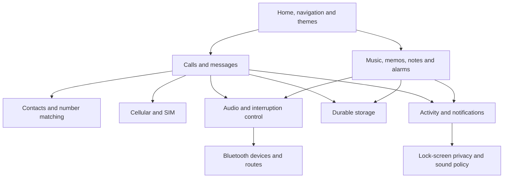
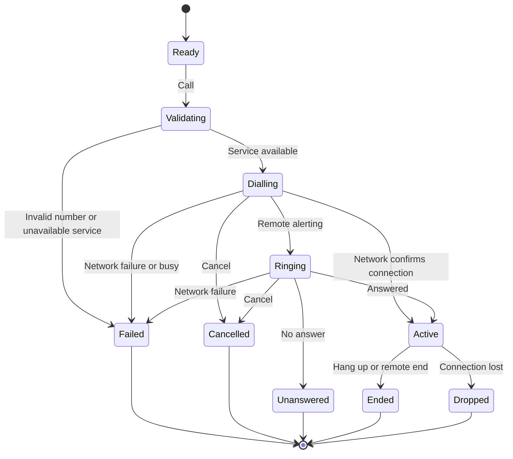
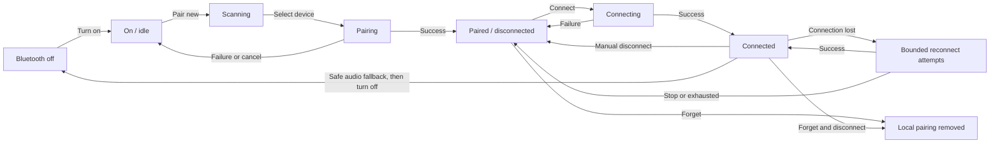

# BlackHand — finished-product feature logic

Status: proposed product behaviour for review. This describes the intended finished product, not the current prototype. It is a capability and interaction map, not an approved hardware specification or implementation plan.

## Product goal and working assumptions

BlackHand is a focused personal device for calls, messages, music, recorded thoughts, and everyday utilities. Essential actions should be quick, explicit, and usable without a cloud account. A coherent theme system gives the device personality without changing how it works.

Working assumptions:

- A standalone cellular device with a compact display, microphone, earpiece, loudspeaker, and local storage.
- Navigation, selection, back, and text entry are available. Physical keys versus touch and the text-entry method remain hardware decisions.
- Bluetooth supports compatible audio accessories. Exact accessory types and capabilities require a hardware decision.
- Contacts, messages, notes, recordings, preferences, and media can be stored locally.
- Notes are proposed as a full feature because they appear in the intended storage model.
- Wi-Fi, mobile internet features, cloud sync, cameras, location services, third-party apps, and Bluetooth file transfer are not assumed.
- Encryption, emergency-call availability, update mechanisms, and supported network/media/accessory standards require technical validation before being promised.

## Capability map

“Uses” identifies the underlying owner of a capability. User journeys may cross between apps in both directions; that does not mean the apps must own each other's data.

| Module | Owns | Uses |
|---|---|---|
| persistence | Durable records, file operations, free-space accounting | Device storage |
| time | Clock, timezone, scheduled wake events | Hardware clock; optional network time |
| cellular | SIM state, network registration, call and message transport | Modem |
| bluetooth | Radio state, discovery, pairing, accessory connections | Bluetooth hardware |
| audio | Microphone/output routing, volume, interruption policy | Audio hardware, bluetooth |
| security | Device lock, protected access, destructive-action verification | persistence, time |
| preferences | User-selected settings and theme choice | persistence |
| contacts | People, numbers, favourites, blocking rules | persistence |
| calls | Call lifecycle and call records | cellular, contacts, audio, persistence, time |
| messages | Conversations, drafts, delivery states | cellular, contacts, persistence, time |
| music | Library, queue, playback position | persistence, audio |
| voice-memos | Recording sessions and saved recordings | persistence, audio, time |
| notes | Note text, titles, saved drafts | persistence, time |
| alarms | Schedules, snooze state, alarm occurrences | persistence, time, audio |
| activity | Compact references to relevant events | Events from feature owners, persistence |
| notifications | Unread/actionable alerts and presentation | Events from feature owners, security, preferences |
| device-system | Power, health, USB, backup, update orchestration | Hardware and relevant feature services |
| interface | Navigation, status bar, screens, settings UI, themes | Feature services, security, preferences |

Suggested development sequence, subject to hardware selection: persistence/time/preferences → hardware adapters/audio/security → contacts → calls/messages → music/memos/notes/alarms → activity/notifications/interface integration → backup/update/recovery verification. The interface can be prototyped throughout using simulated service states.

## Shared interaction rules

1. Navigation has a consistent Home, Back, Select, and Options meaning. Back closes a temporary view or returns one level; it does not silently hang up or discard work.
2. Every feature has loading, empty, ready, busy, success, and failure behaviour where relevant. Failures explain the next useful action.
3. Displayed status comes from the service performing the action. “Saved,” “Connected,” and “Sent” appear only after their respective operations succeed.
4. Locking or leaving a screen does not terminate an active call, music playback, a recording, or an armed alarm. Restrictions on lock-screen controls are explicit.
5. Lists restore their selection and scroll position after returning from a detail view. Newly arriving events should not move the item the user is about to select.
6. Settings survive restart. Temporary operations survive only when recovery is safe and meaningful; uncertain communications are never blindly repeated.
7. Destructive operations identify their exact scope. Reversible local deletion uses a recoverable state where practical; permanent deletion and factory reset require explicit confirmation.
8. Sensitive previews follow the lock-screen privacy preference. Dismissing a notification is separate from deleting its underlying record.

## 1. Home, navigation, and status

**Must show:** time, battery/charging, cellular availability, sound mode, and concise indicators for Bluetooth, missed calls, unread messages, and active background work. Bluetooth enabled and Bluetooth connected are different indicators.

**Actions:** open each app, open recent alerts, return to active call/playback/recording, lock the device, and reach essential quick settings. Favourites or menu reordering are proposed customisation options.

**Logic:** preserve the current task when another app opens. An incoming call presents Answer and Decline; returning after it ends restores the previous screen and draft. Status updates while a screen remains open.

**Connections:** all feature services provide their own status; Home presents it without creating duplicate data.

**Check:** start music, open Contacts, lock/unlock, and return to the same contact while playback continues.

## 2. Calls

**Needs:** usable SIM/network state, supported cellular calling, microphone, an available audio output, and access to contacts and call records.

**Entry points:** dialler, contact, call log, message conversation, and an incoming call.

**Actions:** enter/edit a number, choose a contact number, call, cancel dialling, answer, decline, end, mute/unmute, adjust call volume, choose earpiece/speaker/compatible Bluetooth device, and open an in-call keypad for automated menus. Redial is explicit. Voicemail access is configurable if supported by the service.

**Outgoing states:** ready → validating → dialling → remote ringing → active → ended. Dialling/ringing can also end as cancelled, busy, unanswered, unavailable, or failed. Only network-confirmed connection starts the conversation duration.

**Incoming states:** ringing → answered → active → ended; or declined, missed, cancelled by caller, or blocked. Declined and missed are recorded separately.

**Logic:** keep an active call running while navigating or locking. Show the other party, duration, mute state, and current route. Ending releases the microphone, writes one final call record, and applies media-resume rules. A dropped call offers Retry; it does not redial by itself. A cellular failure must not be displayed as a successful call.

**Interruptions:** pause music. If a memo is recording, an incoming ring first gives a quiet visual/haptic alert; answering saves the memo segment and releases the microphone. If Bluetooth disconnects, move a call to the earpiece, never unexpectedly to loudspeaker. If no private output exists, clearly signal route loss and require output selection.

**Connections:** cellular, contacts, audio, Bluetooth, call log, activity, notifications, lock screen.

**Conditional extensions:** call waiting/hold/conference depend on hardware and carrier support. Do not show controls that cannot work. Emergency-call entry and its availability conditions need a separately validated hardware/network design.

**Check:** call from a message, switch to Bluetooth, disconnect the accessory, end the call, and verify one accurate call record and the correct media-resume behaviour.

## 3. Contacts

**Must store:** stable contact identity, display name, one or more labelled numbers, favourite status, and optional local notes. Numbers retain an intelligible display form and a consistent matching form.

**Actions:** add, search, view, edit, favourite/unfavourite, call, message, block/unblock a number, and delete. Import/export and duplicate merging are proposed supporting functions.

**Logic:** select which number to use when a contact has several. Flag likely duplicates and let the user choose; never silently merge different people. Generate stable identifiers independently of list length. Blocking suppresses local alerts for matching communications; whether network-level rejection is possible must be verified.

**Connections:** Calls and Messages resolve numbers against Contacts. Call/message records retain their original address and a historical display snapshot. Renaming a contact updates its current display identity without rewriting whom a past communication addressed. Deleting a contact leaves calls/messages intact and displays their numbers.

**Check:** delete a contact with existing messages and calls; both histories remain readable and usable.

## 4. SMS and conversations

**Must show:** conversations, sender/recipient, timestamps, unread state, drafts, and per-message sending status.

**Actions:** compose, choose/type recipient, edit text, save draft, send, cancel before submission where possible, reply, call sender, add sender to contacts, copy text, retry a known failure, and delete a message or conversation.

**Outgoing states:** draft → queued locally → submitting → accepted by network → delivered if a supported receipt arrives. Failure is distinct from unknown outcome. “Accepted” is not proof that the recipient received or read the message.

**Incoming logic:** store before signalling successful local receipt; show the correct contact or number; update unread count and notification. Deduplicate using transport identifiers where available, not text alone. Viewing a message marks it read locally; dismissing its alert does not.

**Offline logic:** leaving Compose saves a draft. Pressing Send while offline explicitly offers Queue or Keep draft. Queued items show their recipient/content and can be cancelled before submission. On reconnect, only explicitly queued items are submitted. An interrupted submission with uncertain outcome must be reconciled or shown as uncertain before a manual retry, to avoid duplicates.

**Text rules:** show the length/segment impact supported by the chosen transport. Long-message handling, allowed encodings, and delivery receipts need modem/network validation. MMS, attachments, internet messaging, and group conversations are separate scope decisions.

**Connections:** cellular, contacts, storage, notifications, calls, time, security.

**Check:** compose offline, keep a draft, restart, reconnect; the draft remains and is not sent without a send instruction.

## 5. Call log

**Must show:** incoming/outgoing/missed/declined/failed calls; contact or number; date/time; connected duration; and useful failure detail.

**Actions:** filter, inspect details, call back, message, save an unknown number, delete selected records, or clear the log with an explicit scope confirmation.

**Logic:** each attempt has a stable identity and one final outcome. Duration means connected time, not time spent ringing. Grouping repeat calls is a display convenience; individual records remain inspectable. Deleting a log entry does not delete a contact or conversation. Acknowledging missed calls clears their associated alert state.

**Connections:** Calls owns the records; the log, Home, and activity history present them.

**Check:** cancel before the other party answers; the record shows cancelled with no connected duration.

## 6. Bluetooth

**Main screen:** On/Off, current connections, saved/paired devices, and Pair new device. A saved device is not necessarily nearby or connected.

**Saved-device details:** device name/type, connection state, supported uses, optional reported battery level, auto-connect preference, and Connect / Disconnect / Forget actions. A local display alias is optional.

**New connection flow:** Bluetooth on → scan → show discovered devices → choose one → pair/confirm where required → connect supported services → save pairing after success. Provide Cancel and scan timeout states. Pairing failure explains whether to retry, move closer, or place the accessory in pairing mode.

**States:** off; on/idle; scanning; pairing; paired/disconnected; connecting; connected; reconnecting; failed. Track these per accessory where relevant.

**Disconnect versus forget:** Disconnect ends the current session while retaining pairing. Suppress immediate automatic reconnection after manual disconnection until the user connects again or explicitly re-enables auto-connect. Forget disconnects, removes local pairing material/preferences, and prevents future automatic reconnection; it does not claim to erase BlackHand from the other device.

**Turn off:** stop discovery and connections; keep saved pairings. When audio is active, apply the safe fallback first. Music pauses instead of suddenly playing through the speaker. Calls use the earpiece where available. Turning Bluetooth back on may reconnect an eligible saved device according to the user's preference, without starting previously paused music by itself.

**Multiple devices:** distinguish paired-device capacity, simultaneous connection capacity, and the one selected route for each audio use. Exact concurrency requires hardware validation. Show which accessory handles calls and media; permit separate assignments only when supported.

**Privacy:** advertise discoverability only during explicit pairing windows where possible. Do not pair automatically with unknown devices. Repeated failures stop after bounded attempts and offer manual retry.

**Connections:** audio router, calls, music, memo playback, sound settings, power management.

**Check:** pair headphones, disconnect manually, ensure they stay disconnected, reconnect, then forget; they must no longer auto-connect.

## 7. Cellular and SIM

**Must show:** no SIM, SIM locked, searching, registered, no service, available calling/messaging status, operator, and signal indication.

**Actions:** enable/disable cellular through radio controls, enter SIM PIN when required, view SIM status, configure supported network preferences, and access carrier-specific settings only where supported.

**Logic:** distinguish a device lock from a SIM lock. Never repeatedly submit a failing SIM PIN automatically. Loss of service updates Calls and Messages immediately; queued-message rules determine what happens when it returns. Detect SIM replacement and make its consequences visible before sending queued communications through a different identity.

**Connections:** calls, messages, status bar, airplane mode, optional automatic clock setting.

**Conditional:** physical SIM versus eSIM, dual SIM, roaming controls, mobile data, network bands, and carrier compatibility require hardware/service decisions. Voice/SMS availability and mobile-data availability are separate states.

**Check:** remove service during a call or message submission; the UI shows the true failure/uncertain outcome and does not fabricate success.

## 8. Sound, audio routing, and interruptions

**Controls:** separate call, media, ringtone/notification, and alarm volumes; silent/vibrate/ring modes; tone selection; output selection; microphone mute during calls. Haptics depend on installed hardware.

**Logic:** use an explicit audio owner and route, so apps cannot independently fight for the microphone or speaker. Never unexpectedly expose private call or media audio through the loudspeaker.

| Event | Required interaction |
|---|---|
| Incoming call during music | Pause music while ringing; handle resumption under the policy below |
| Incoming call during recording | Quiet visual/haptic alert; answering saves the current segment before the call takes the microphone |
| Call ends or ring stops | Resume music only if the interruption paused it, user preference permits resume, the route is still suitable, and no later user action or other audio owner overrides it |
| Alarm during music | Pause music; play alarm using the alarm-output policy; dismiss/snooze before considering media resumption |
| Alarm during active call | Show an alert and quiet in-call/haptic indication; do not replace call audio with a full-volume alarm; expose Snooze/Dismiss |
| Alarm during recording | Save/pause the segment before audible alarm output; require explicit recording resume |
| Notification during call/recording | Use visual/haptic presentation; avoid audible contamination of the microphone |
| Bluetooth loss during music | Pause and show disconnected route |
| Bluetooth loss during call | Switch to earpiece where available; notify without terminating the call |
| Manual pause during interruption | Cancel any pending automatic media resume |

**Check:** start music, receive a call, manually pause playback during the interruption, end the call; music remains paused.

## 9. Music

**Must show:** library by track/artist/album where metadata exists, queue, now playing, progress, duration, volume, and audio output.

**Actions:** play/pause, previous/next, seek, browse/search, enqueue/remove/reorder, shuffle, repeat off/track/queue, resume position, and delete local files through storage rules. Playlists are proposed.

**States:** library empty/scanning/ready; playback stopped/loading/playing/paused/interrupted/ended/error.

**Logic:** choosing a song defines its queue context. Missing metadata falls back to readable filenames. Corrupt or unsupported tracks explain the problem; automatic advance must stop rather than loop forever through a broken library. Locking or leaving Music allows playback to continue. Reboot can restore the queue and position, but does not start audible playback automatically.

**Connections:** local storage/import, audio, Bluetooth, calls, alarms, lock-screen controls.

**Conditional:** media formats, maximum library size, and wired audio support are hardware/software decisions. Streaming is not assumed.

**Check:** disconnect headphones mid-track; position is retained and speaker playback does not start.

## 10. Voice memos

**Must show:** recordings list, title/date/duration/size, recording timer, recording state, and estimated remaining capacity.

**Actions:** record, pause/resume, stop/save, rename, play/pause/seek, delete, and export through the approved transfer mechanism.

**States:** idle → preparing → recording ↔ paused → finalising → saved; plus permission/device unavailable, storage low/full, interruption, and recoverable error.

**Logic:** reserve/check space before starting; write incrementally so a restart does not discard an entire session. Save before yielding the microphone to an answered call or audible alarm. Do not resume recording secretly after an interruption. Locking keeps recording active with an unmistakable indicator and deliberate stop control. Playback speed is optional.

**Connections:** microphone/audio owner, storage, calls, alarms, power, notifications.

**Check:** storage becomes full during recording; preserve the valid recorded portion, stop cleanly, and show the reason.

## 11. Notes

**Must show:** titles, preview text, modified time, saved/unsaved state, and search results.

**Actions:** create, edit, rename, search, pin/unpin, delete, and export. Keep formatting plain and predictable.

**Logic:** autosave after a short idle interval and when leaving the editor. Show Saved only after durable completion. Preserve the current draft through calls and screen locks. If a save fails, retain the text in the session, visibly report failure, and offer retry or export; do not falsely promise restart recovery.

**Connections:** text entry, storage, time, backup/export, optional activity events.

**Check:** receive a call while editing; after returning, the text and cursor position remain.

## 12. Alarms and clock

**Must show:** current local date/time/timezone, alarm list, enabled state, repeat days, label, and next occurrence.

**Actions:** add/edit/delete, enable/disable, choose time/repeat/label/tone/volume, set snooze length, snooze, and dismiss. Timer and stopwatch are optional separate utilities.

**States:** disabled → armed → ringing → dismissed; or ringing → snoozed → ringing. A repeating alarm arms its next occurrence after the current one is dismissed; a one-shot alarm disables after completion.

**Logic:** show whether an alarm is tomorrow or later in the week. Give each occurrence an identity so it cannot ring twice after restart. Recalculate schedules on clock/timezone changes. Proposed daylight-saving policy: on a skipped local time, trigger at the first valid time after the gap; on a repeated time, trigger once. Surface the next occurrence so the user can inspect the result.

**Restart:** restore future alarms. An occurrence missed while off appears as missed; do not produce a burst of old alarms on startup. Waking a powered-off device is promised only if supported and verified by the hardware.

**Sound policy:** by default, enabled alarms remain audible in Silent and Do Not Disturb. This is clearly shown in settings. Use the device speaker by default so sleeping headphones do not swallow an alarm; calls/recordings follow the interruption table. Offer a deliberate alternative-output preference only if dependable.

**Connections:** clock, scheduler, audio, lock screen, notifications, power.

**Check:** snooze, restart before the snooze expires, and verify a single restored future occurrence.

## 13. Storage and file management

**Must show:** total/used/free space; usage by music, recordings, notes, messages, and system data; removable-media state if supported.

**Actions:** browse supported files, inspect size/type, rename where meaningful, delete/recover, import/export, and format removable storage only through explicit destructive confirmation.

**States:** ready, low space, full, read-only, unavailable, scanning, or error.

**Logic:** establish a measured reserve for critical communication records and settings. Warn before it is consumed; cap media writes rather than silently deleting personal files. Incoming data beyond actual capacity produces an explicit failure/status handled with the transport. Never fake saved messages or recordings. Storage usage derives from actual durable data, not UI counters.

**Deletion:** distinguish deleting a playlist reference from its audio file, or removing an activity item from its source. Coordinate deletion of active files with playback/recording. Show recoverable-deletion space use; emptying recovery storage is a separate permanent action.

**Connections:** every data-producing feature, USB, backup, updates, device health.

**Check:** fill media storage; critical state can still be written within its reserve and the user receives a useful capacity warning.

## 14. Activity history

**Must show:** a compact chronological timeline of selected events such as completed/missed calls, messages, saved recordings, and notable device events. Filtering is available.

**Actions:** open an event's source, filter, and clear activity history separately from source records.

**Logic:** feature owners emit one stable event per meaningful occurrence. Avoid filling the timeline with every keystroke or every note autosave. Use stored timestamps and explicit timezone handling. If the source is removed, remove its sensitive preview and link; a neutral removed-item marker is optional. Do not retain private message text after the user deletes its source.

**Connections:** calls, messages, memos, storage, device events, lock-screen privacy.

**Check:** delete a message; Activity cannot reveal its old content or open a stale conversation item.

## 15. Notifications and Do Not Disturb

**Must show:** missed calls, unread messages, upcoming/actionable device warnings, and ongoing call/recording states.

**Actions:** open, dismiss, acknowledge where appropriate, adjust preview privacy, enable/disable Do Not Disturb, schedule it, and choose allowed callers/alarms. Repeated-caller exceptions are optional.

**Logic:** distinguish DND from Silent and radio-off modes. DND controls interruptions; it does not prevent message storage or network registration. Proposed default: alarms remain allowed, other audible alerts are suppressed, exceptions are explicitly selected. A queued alert is not replayed as a burst of sounds when DND ends.

**Connections:** calls, messages, alarms, audio, time, security, battery/storage services.

**Check:** receive an SMS during DND; save it and update unread state without an audible interruption.

## 16. Themes, display, and accessibility

**Controls:** choose among all twelve themes; preview/apply/cancel; brightness, screen timeout, supported text size, contrast, and reduced animation options. Automatic brightness depends on a sensor.

**Logic:** theme choice changes presentation without changing action meanings or feature availability. Current selection, disabled controls, warnings, recording, and call state must remain recognisable without colour alone. Long names and large text must remain accessible through wrapping, scrolling, or detail views. A theme preview is reversible; applying saves it across restart.

**Connections:** all screens, preferences, power/display, input focus.

**Check:** switch themes during a call or unsent message; state, focus, and draft remain intact.

## 17. Security and lock screen

**Controls:** set/change device PIN, lock now, auto-lock timing, message preview privacy, and choose allowed lock-screen actions. SIM PIN is presented separately.

**Logic:** prevent accidental actions and unauthorised access to stored personal content. Rate-limit failed unlock attempts without an unapproved automatic-wipe policy. Proposed default: allow answering/ending an incoming call and stopping an alarm while locked; require unlock for contact browsing, message reading, and settings. Recording can continue with a clear indicator and stop control.

**Recovery:** forgotten-PIN recovery, secure reset, protected storage, and hardware key management must be designed together before claims about data protection are made. A cosmetic lock screen is not a complete security design.

**Connections:** notifications, calls, alarms, memos, USB, backup, updates, reset.

**Check:** a locked incoming-message alert follows preview settings and cannot be used to browse other messages.

## 18. Battery, power, and airplane mode

**Must show:** battery level, charging/full/fault state, low-power warning, and active power-saving mode.

**Actions:** power off/restart, enable battery saver, change display timeout, and enable/disable airplane mode.

**Logic:** orderly shutdown saves drafts, finalises recordings, and reports an active call before termination. Battery saver dims/reduces nonessential background work while preserving armed alarms and essential communication where hardware permits. Never claim exact remaining runtime without a supported estimate.

**Airplane policy:** enabling airplane mode disables cellular and Bluetooth by default. The user may explicitly re-enable Bluetooth while airplane mode remains on; the UI shows cellular still off. If a call is active, warn that enabling the mode will end it. Leaving airplane mode restores the prior desired radio settings unless changed explicitly while in the mode. Do not send uncertain messages simply because radios return.

**Connections:** radios, calls, recordings, storage, alarms, status bar.

**Check:** enable airplane mode, re-enable Bluetooth, and play local music while cellular remains disabled.

## 19. USB, import, export, and backup

**Proposed controls:** charge-only default; explicitly enable file transfer; import music/contacts; export recordings/notes; create and restore a local backup.

**Logic:** connecting a cable does not immediately expose personal data. Require unlock and explicit transfer selection. Validate imports and explain unsupported files. Transfer writes are completed safely or leave a recoverable partial state. Concurrent file access requires coordination so a computer cannot corrupt a file the device is writing.

**Backup:** explain included categories, destination, available space, and protection. Sensitive pairing material and hardware-bound secrets are not portable user content by default. Restore previews overwrite versus merge behaviour, validates compatibility, and preserves a recoverable previous state where feasible. Restoring messages does not send drafts or resubmit old queued items; require explicit review before sending recovered items.

**Connections:** security, storage, contacts, messages, music, memos, notes, preferences.

**Conditional:** USB capabilities, removable media, backup encryption, transfer protocol, and restore compatibility require platform decisions. Cloud backup is not assumed.

**Check:** restore a backup containing an unsent message; it remains unsent until reviewed and explicitly queued/sent again.

## 20. Settings, device information, updates, and reset

**Settings groups:** connectivity; sound; display/themes; date/time; security; storage; accessibility; device information; backup/recovery.

**Information:** software version, model, hardware-supported identifiers, storage health, and useful radio/device status. Sensitive identifiers should not be exposed unnecessarily on the lock screen or exports.

**Updates, if supported:** discover/import update → verify trusted package and compatibility → check space/power → show user-facing changes → obtain install instruction → install safely → restart → confirm health. Defer disruptive work during calls or recordings. Define recovery before shipping the update feature.

**Reset types:** reset preferences; reset network/Bluetooth configuration; erase personal content/factory reset. Each lists exactly what is removed and retained. Factory reset requires an explicit final confirmation and a separately verified data-erasure design.

**Connections:** all preference owners, security, power, storage, platform update mechanism.

**Check:** resetting themes/sound preferences does not erase contacts; resetting Bluetooth removes local pairing state; full reset does not imply unverified removal of data on external accessories or backup destinations.

## Cross-feature journeys

### Shared service connections

### Outgoing call states

### Bluetooth saved-device lifecycle

Manual disconnection suppresses automatic reconnection until explicitly enabled again. Turning the radio off cancels any in-progress scan, pairing, connection, or retry; saved pairings survive. Forgetting a device removes the local record and reconnection eligibility.

### Call from a message

Conversation → Call sender → resolve contact/number → check cellular availability → dial → choose audio route → active call → end → finalise call log → update activity → return to conversation.

Failure before connection returns to the conversation with a useful status and leaves the draft intact. It does not produce a connected duration.

### Pair headphones and listen

Settings → Bluetooth on → Pair new → scan → select headphones → confirm pairing if required → connect media service → choose in Music → play.

Accessory loss pauses playback. Reconnection restores route availability, not automatic audible playback. Disconnect keeps the pairing; Forget removes local pairing and auto-connect settings.

### Record a thought and answer a call

Start recording → receive quiet incoming-call alert → Answer → finalise memo segment → release microphone → active call → end → show saved interrupted memo → user chooses whether to start/resume recording.

### Receive a message with little storage

Transport reports incoming message → attempt durable write from the communication reserve → on success update conversation/unread/notification → on failure present a capacity error and apply the verified transport recovery policy.

The UI never displays a durable-save success based only on arrival in memory.

## Decisions to settle before implementation

1. Hardware: screen/input method, modem, SIM type, microphones/speakers, vibration, battery/charging, USB, removable storage, and clock/wake support.
2. Product scope: SMS only versus attachments/groups; notes as a first-class app; playlists; timers/stopwatch; optional connectivity/internet features.
3. Audio/accessories: supported Bluetooth uses, simultaneous connections, wired audio, microphone selection, and exact interrupt/resume preferences.
4. Safety/reliability: emergency-call design, alarm behaviour while powered off, storage reserves, power-loss recovery, and network-outcome reconciliation.
5. Privacy/security: device lock and recovery, storage protection, backup protection, erasure, and trusted updates.
6. Capacity/retention: realistic limits for contacts, messages, recordings, library size, call history, activity, and recoverable deletions.

These decisions refine the map; they do not require reducing it to disconnected screen mockups. Each final feature needs both its own state machine and a tested contract with the shared services it uses.
